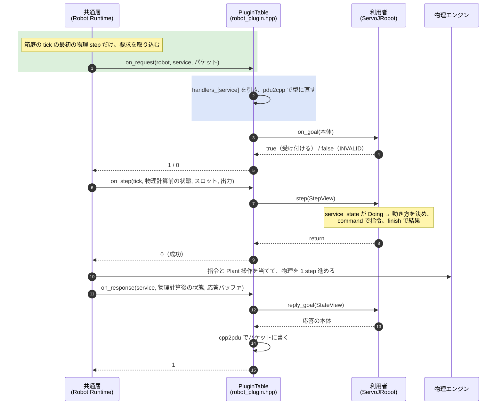

# ロボットのサービスプラグインは中でどう動くか

この文書は、プラグインの仕組みを知りたい人と、枠組みを直す人のためのものです。
プラグインの書き方は [howto-add-async-service.md](howto-add-async-service.md) を読んでください。
例には SO-101 のサンプル [servoj_like.cpp](../examples/service_plugins/servoj_like/servoj_like.cpp) を使います。

## 1. 3 つの層

| 層 | ファイル | 誰が書く | すること |
|---|---|---|---|
| C の約束ごと | [service_plugin.h](../include/hakoniwa/robot_runtime/plugin/service_plugin.h) | 枠組み | 関数表 `HakoServicePluginV1`。型を知らず、PDU のパケットをバイト列とサイズで渡す |
| C++ の土台 | [robot_plugin.hpp](../include/hakoniwa/robot_runtime/plugin/robot_plugin.hpp) | 枠組み | `detail::PluginTable` が関数表を実装し、パケットと型を変換して、利用者の関数を呼ぶ |
| 利用者のコード | `servoj_like.cpp` | 利用者 | マクロでサービスの型と入口を宣言し、コンストラクタで要求・応答の関数を `bind` し、`step` を書く（`reset`・`cancel` は必要なときだけ） |

共通層（Robot Runtime）は、入口の関数から関数表を受け取り、そのあとは関数表だけを通してプラグインを呼びます。
関数表のうち要求と応答だけは PDU のパケット全体をバイト列で渡し、状態や出力は C の構造体で渡します。
利用者のクラスは C の関数表を知りません。
その間をつなぐのが `PluginTable` です。

関数表の各項目と、`PluginTable` がそこで呼ぶ利用者の関数は次のとおりです。

| 関数表 | 共通層が呼ぶとき | `PluginTable` がすること | 呼ばれる利用者の関数 |
|---|---|---|---|
| `declaration_json` | 起動時の検査 | `HAKO_ROBOT_PLUGIN` に並べた型から作った宣言 | なし |
| `create` | ロボットを作るとき | クラスを作り、宣言した型と `bind` した型が合うか確かめる | コンストラクタ（中で `bind`） |
| `on_request` | 要求が届いたとき | パケットを型に直す | `bind` した要求の関数（例 `on_goal`） |
| `on_cancel` | 取り消しが届いたとき | そのまま渡す | `cancel`（書かなくてよい） |
| `on_step` | 毎 step 1 回 | 状態・スロット・出力を `StepView` に包む | `step` |
| `on_response` | 結果を返したサービスの応答 | 戻り値をパケットに書く | `bind` した応答の関数（例 `reply_goal`） |
| `reset` | シミュレーションのリセット | そのまま渡す | `reset`（書かなくてよい） |
| `destroy` | 終了時 | クラスを壊す | デストラクタ |

決まった名前は `step`、`reset`、`cancel` だけです。
要求と応答の関数の名前は利用者が決め、`bind` で組にします。

C++ の例外は `PluginTable` の中で止まり、C の側には漏れません。
- `create`：エラーの文字列を書いて、作成失敗を返す
- `on_request`：0（INVALID）を返す
- `on_step`：エラーの文字列を書いて、失敗を返す
- `on_response`：0（書き込み失敗）を返す
- `cancel`・`reset`：何も知らせずに戻る

デストラクタは例外を投げないようにします。

## 2. 1 回の step の流れ

箱庭の 1 tick は、物理の step（substep）を 1 回以上まとめたものです。
図は、1 tick = 1 物理 step の構成で、ServoJ の要求を受け付けて応答する場合です。
緑の帯は共通層からの呼び出し、青の帯は C++ の土台の中の処理です。



`on_goal` が `false` を返したときは、そのサービスは Idle のまま `step` に渡り、`reply_goal` は呼ばれません。
共通層が INVALID の応答を送ります。

要点は次の 5 つです。

- **要求を受け取るのは `on_goal`、判断するのは `step`** です。`on_goal` は受け付けるかを決めて中身を覚えるだけで、関節は動かしません。
- **要求を取り込むのは、tick の最初の物理 step の頭だけです。** そこで `on_goal` が呼ばれ、続けてすぐ同じ物理 step の `step` が呼ばれます。tick の途中で届いた要求は、次の tick の頭で取り込まれます。
- **`step` は、要求がなくても物理 step ごとに 1 回呼ばれます。** ロボットのすべてのサービスの状態が、`StepView` からまとめて見えます。同じ step に ServoJ と Stop が来たときの優先も、`step` の中の 1 か所で決められます。
- **応答は tick の最後の物理 step のあとです。** その tick の中で `finish` したサービスの応答関数（例 `reply_goal`）が、tick の終わりにまとめて呼ばれます。4 物理 step の tick で最初の step に `finish` しても、応答関数には 4 回目の物理計算のあとの状態が渡ります。
- **lockstep かどうかで、`finish` の期限が違います。**
  - lockstep の要求は、受け付けた最初の物理 step の `step` で `finish` しなければなりません。しなければエラーです。
  - lockstep でない要求は、`finish` せずに（Pending のまま）次の step、次の tick へ持ち越せます。
  - GetAngle は lockstep でないので、物理時刻を進める条件に加わりません。届いた次の tick で受け付け、その tick の終わりに応答します。

## 3. `on_goal` が呼ばれるまで

`on_goal` はサンプルが付けた名前で、C++ の土台は名前に依存しません。
`bind` に渡されたメンバ関数ポインタを覚えておき、要求が来たらその関数を呼びます。

### 3.1 利用者が `bind` する

```cpp
servo_service = bind<ServoJService>(&ServoJRobot::on_goal, &ServoJRobot::reply_goal);
```

- `ServoJService` は `HAKO_ROBOT_SERVICE(my_robot_srvs_msgs, ServoJ)` が作った型の組です。要求・応答の型、変換器、型名 `my_robot_srvs_msgs/ServoJ` を持っています。
- `bind` は、そのロボットのサービスから型名が一致するものを 1 つ探し、その番号を返します。
  - 見つからないとき、2 つ以上あるとき、同じサービスに 2 回 `bind` したときは、例外になります（create の失敗）。
  - 同じ型のサービスが 2 つあるロボットでは、番号を指定する `bind<Service>(番号, …)` で対象を選びます。番号は manifest のそのロボットの `services` の順番（0 から）です。型が 1 つだけでも番号版は使えますが、ふつうは型で探すほうを使います。

### 3.2 `bind` が関数をしまう

`bind` は、受け取った 2 つの関数を `request_handler` と `response_handler` という引数で受け取ります。
そして、それぞれを包んだ処理を `handlers_[番号]` にしまいます。
要求の側の処理は、次のように読めます。

```cpp
if (!converter.pdu2cpp(bytes, packet)) {
    return false;
}
// Call the author's request function (for example on_goal) with the body only.
return (static_cast<Self&>(plugin).*request_handler)(packet.body);
```

| 部分 | 意味 |
|---|---|
| `converter.pdu2cpp(bytes, packet)` | 生成した変換器で、PDU のバイト列を `HakoCpp_ServoJRequestPacket` に直す。失敗したら INVALID |
| `static_cast<Self&>(plugin)` | 土台が持つ基底クラス `RobotPlugin` の参照を、利用者のクラス `ServoJRobot` に戻す |
| `.*request_handler` | `bind` で受け取ったメンバ関数（中身は `&ServoJRobot::on_goal`）を、このオブジェクトで呼ぶ |
| `(packet.body)` | ヘッダを除いた本体 `HakoCpp_ServoJRequest` だけを渡す |

戻り値が、そのまま受け付けるかどうかになります。

| 場合 | 戻り値 | どうなるか |
|---|---|---|
| 型に直せなかった | `false` | INVALID で応答 |
| `on_goal` が `false` を返した | `false` | INVALID で応答（Stop の `mode = 1` はこれ） |
| `on_goal` が `true` を返した | `true` | 受け付け。同じ step の `step` で Doing になる |

応答の側も同じ形です。
応答バッファのヘッダを読み、本体を `response_handler`（中身は `reply_goal`）の戻り値で置き換え、`cpp2pdu` で書き戻します。

### 3.3 共通層から `handlers_` まで

要求が届いたとき、呼び出しは次の順に進みます。

1. 共通層の `RobotServiceSource` が、tick の最初の物理 step の前に、ロボットのサービスを番号順に見て回り、サービスごとの `AsyncServiceCommandSource::poll` を呼びます（[async_service_pipeline.cpp](../src/runtime/service/async_service_pipeline.cpp)）。
2. 要求があれば `ServicePlugin::on_request` を呼び、関数表の `on_request` に渡します（[service_plugin_adapter.cpp](../src/runtime/service/service_plugin_adapter.cpp)）。ここまではバイト列のままです。
3. `PluginTable::on_request` が `handlers_[service].request` を呼びます。
4. 3.2 の処理が型に直し、`on_goal` を呼びます。

## 4. `StepView` と `StateView`

| | `StepView` | `StateView` |
|---|---|---|
| 渡される関数 | `step` | 応答の関数（例 `reply_goal`） |
| 状態 | 物理計算の**前** | 物理計算の**後** |
| 読む | `tick()`、`position(i)`、`velocity(i)`、`effort(i)`、`body(i)`、`humanoid(i)`、`pdu(i)` | 同じ |
| サービス | `service_state(番号)` で Idle / Doing / Canceling を見る。`finish(番号, 結果)` で Ok / Canceled / Error を返す | なし |
| 出力 | `command(i, 値)` で関節の指令。Plant 操作 `surface_friction`、`body_motion`、`humanoid_motion` | なし |

`StepView` は `StateView` に「サービスの状態を見て結果を返す」「出力する」を足したものです。
応答の関数には `StateView` しか渡らないので、応答の中から指令は出せません。

関節の番号 `i` は、manifest のアクチュエータの順番です。
GetAngle が「物理計算前の角度」を返すのは、受け付けた step の `step` で `step.position(i)` を読み、応答までメンバに持ち越しているからです。

## 5. やってはいけないこと

- **要求の関数（`on_goal` など）の中で動かし始めない。** 要求の関数に渡るのは要求の本体だけで、関節の状態も指令の出し口もありません。中身を覚えて、すぐ後に呼ばれる `step` の Doing で動かし始めます。
- **渡されたものを、呼び出しの外で使わない。** `StepView`、`StateView`、要求の本体は、その関数の呼び出しの間だけ有効です。後で使う値は、メンバにコピーしておきます。
- **次の制御に関わる状態は `step` で変える。** 応答の関数は、物理計算後の状態や覚えておいた値から応答の本体を作るためのものです。C++ の上ではメンバを書き換えられますが、制御の判断は `step` に集めます。
- **Doing のサービスに `finish` を忘れない。** `finish` するまで応答は返りません。lockstep の要求は、受け付けた物理 step の `step` で `finish` しないとエラーになります。長く動くサービス（ServoJ）は、受け付けた step で `finish(Ok)` を返してから動き続けます。この Ok は「受け付けて動き始めた」で、「動き終わった」ではありません。
- **要求の中身が不正なだけなら、例外ではなく `false` を返す。** `false` なら INVALID の応答で済みます。`step` が例外を投げると、その呼び出しの指令は使われず、処理中のサービスはすべて Error になります。そのロボットに lockstep のサービスが 1 つでもあれば、シミュレーションが止まります。
