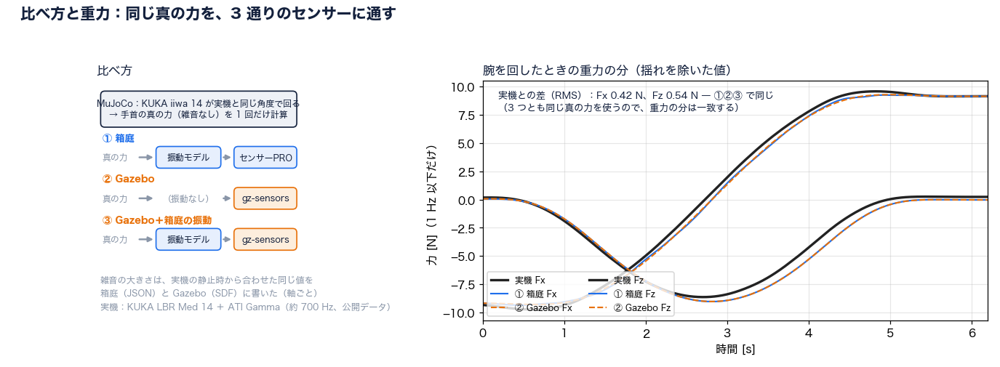
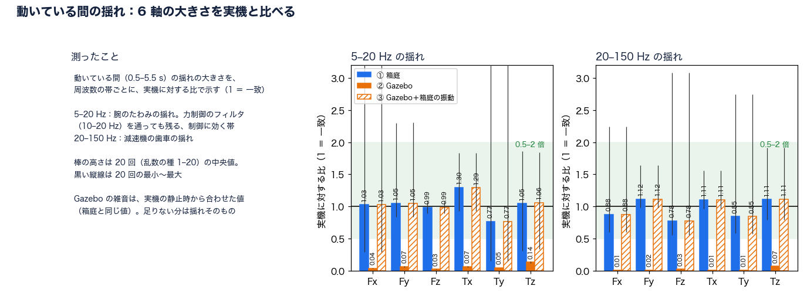
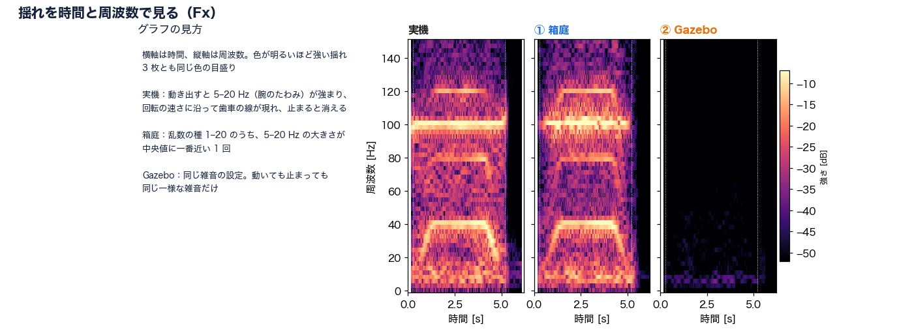
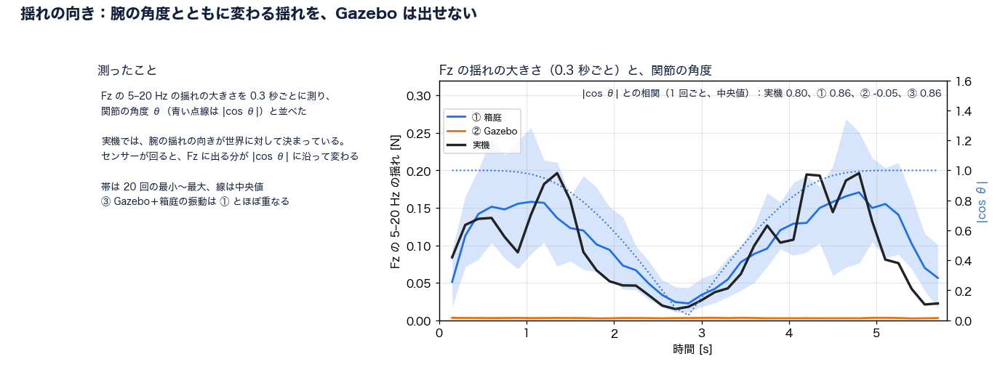
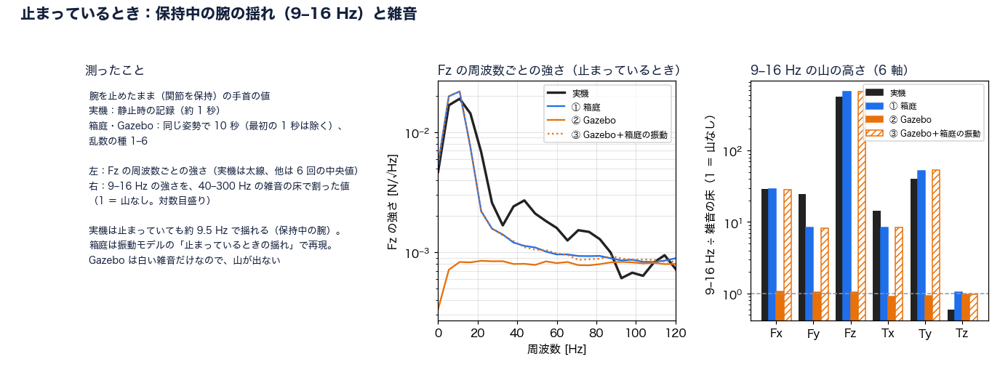

# 手首の力覚センサーを実機の記録と比べる：箱庭と Gazebo（2026-11-21）

[English](gazebo-comparison.md) | 日本語

シミュレーションの手首の力覚センサーは、本物にどこまで近いのでしょうか。KUKA の腕の実機の記録を1つのものさしにして、同じ真の力を、3通りのセンサーに通して比べました。

1. **箱庭**：センサーPRO と、その手前の振動モデル
2. **Gazebo**：gz-sensors 10.2.0（Gazebo の実装そのもの）
3. **Gazebo＋箱庭の振動**：Gazebo のセンサーの手前に、箱庭の振動モデルを置いたもの

物理は3つとも同じです。MuJoCo が手首の真の力を1回だけ計算し、センサーだけを [hakoniwa-sensor-adapter](https://github.com/hakoniwalab/hakoniwa-sensor-adapter) の共通のインタフェースで入れ替えています。

**まとめ。** 重力の分と雑音は、3つとも実機と合います。腕が動いているあいだ、実機のセンサーには腕の揺れも乗ります。箱庭は 5–20 Hz の揺れを、6軸で実機の 0.77–1.30 倍で再現しました。揺れを表す仕組みのない Gazebo は 0.03–0.14 倍です。Gazebo のセンサーの手前に箱庭の振動モデルを置くと、Gazebo も箱庭と同じ結果になります。

## 何を、どう比べたか

- **実機**：Zenodo の記録 11096791（A. Skrede、2024 年、CC BY 4.0）。KUKA LBR Med 14 に ATI Gamma の力覚センサー（約 700 Hz）と 0.93 kg の道具を付け、関節を1本、約 5 秒で 180° 回します。別に、腕を止めたままの記録（約 1 秒）があります。センサーのバイアスは、記録の 24 姿勢の校正から求めて引いています。
- **シミュレーション**：KUKA iiwa 14（MuJoCo Menagerie）が、記録と同じ角度で関節を回します。手首の真の力を1回だけ計算し、3通りのセンサーに渡します。動いているときは 20 回（乱数の種 1–20）、止まっているときは 10 秒を 6 回です。
- **雑音は3つとも同じ**：実機の静止時から合わせ込んだ軸ごとの σ を、箱庭（JSON）と Gazebo（SDF の 1 サンプルごとの `stddev`）に書きました。箱庭も Gazebo も、この周期で設定どおりの σ を出します（（出力 − 真値）÷ σ が 0.99–1.00）。
- **揺れ**は、箱庭の振動モデル T14 です（モーターの回転に追従する次数の線、構造の共振、全体の底上げ、1回ごとのばらつき、荷重の向き）。同じ記録に合わせ込みました。仕様は公開しています（[force-torque-vibration.md](https://github.com/hakoniwalab/hakoniwa-sensor-adapter/blob/main/docs/spec/force-torque-vibration.md)）。センサーの手前に置く部品なので、Gazebo のセンサーにも渡せます。
- Gazebo の力覚センサーには、ガウス雑音、一定のバイアス、ゆっくり変わるバイアス、量子化があります。動く腕の揺れを表す仕組みはありません。これは Gazebo のモデルの性質で、今回の設定の不備ではありません。

## 測定カード

どのカードも色は同じです。実機＝黒、箱庭＝青、Gazebo＝オレンジ、Gazebo＋箱庭の振動＝オレンジの斜線または点線。

### 比べ方と重力



- **測ったこと：** 手首が回るときの Fx と Fz の 1 Hz 以下（揺れを除いた値）。
- **グラフの見方：** 左は3通りの作り方、右は実機とシミュレーションの値。
- **結果：** 実機との差（RMS）は Fx 0.42 N、Fz 0.54 N（変化の幅 ±10 N に対して）。真の力が共通なので、3つとも同じです。

### 動いているときの揺れ



- **測ったこと：** 動いているあいだ（0.5–5.5 秒）の揺れを2つの帯に分け、実機に対する比で示しました。5–20 Hz は腕のたわみで、力制御のフィルタ（10–20 Hz）を通っても残る帯です。20–150 Hz は減速機の歯車の揺れです。
- **グラフの見方：** 棒は 20 回の中央値、黒い縦線は 20 回の最小〜最大。1 が一致、緑の帯は 0.5–2 倍。
- **結果：**
  - 5–20 Hz：箱庭 0.77–1.30、Gazebo 0.03–0.14、Gazebo＋箱庭の振動 0.77–1.29。
  - 20–150 Hz：箱庭 0.78–1.12、Gazebo 0.01–0.07、Gazebo＋箱庭の振動 0.78–1.12。
  - 箱庭の Fx と Ty は、1回ごとのばらつきが大きく出ます（5–20 Hz で1回ごとに 0.5–9 倍）。振動モデルの「1回ごとのばらつき」によるものです。

### 時間と周波数



- **測ったこと：** Fx を時間と周波数で見た図（3枚とも同じ色の目盛り）。箱庭は、5–20 Hz の大きさが中央値に一番近い1回。
- **結果：** 実機と箱庭は同じ模様です。約 40・80・120 Hz の歯車の線が速さに合わせて立ち上がって消え、100 Hz に一定の線があり、20 Hz 以下に腕のたわみがあり、止まると全部消えます。Gazebo には、そのどれも出ません。

### 揺れの向き



- **測ったこと：** Fz の 5–20 Hz の揺れを 0.3 秒ごとに測り、関節の角度 θ と並べました。実機では揺れの向きが世界に対して決まっているので、センサーが回ると、Fz に出る分が |cos θ| に沿って変わります。
- **結果：** |cos θ| との相関（1回ごと、中央値）は、実機 0.80、箱庭 0.86、Gazebo −0.05、Gazebo＋箱庭の振動 0.86。

### 止まっているとき



- **測ったこと：** 腕を止めたまま（関節を保持）の手首の値。実機は静止時の記録、シミュレーションは同じ姿勢で 10 秒（最初の 1 秒は除く）。
- **グラフの見方：** 左は Fz の周波数ごとの強さ、右は 9–16 Hz の強さを 40–300 Hz の雑音の床で割った値（1 ＝ 山なし、対数目盛り）。
- **結果：**
  - 雑音の床（40–300 Hz）は、3つとも実機の 0.88–1.07 倍。
  - 実機は止まっていても約 9.5 Hz で揺れています。9–16 Hz ÷ 雑音の床は、Fx 29、Fy 25、Fz 561、Tx 14、Ty 40。箱庭は Fx 29、Fy 8、Fz 673、Tx 8.5、Ty 53 で、Fz の山も 9.5 Hz です。Gazebo はどの軸も 0.9–1.1（山なし）です。

## 一覧

| | 箱庭 | Gazebo | Gazebo＋箱庭の振動 |
|---|---|---|---|
| 重力の分、実機との差（Fx / Fz） | 0.42 / 0.54 N | 同じ | 同じ |
| 静止時の雑音の床、実機に対する比 | 0.88–1.07 | 0.88–1.07 | 0.88–1.08 |
| 静止時の 9.5 Hz の揺れ | ある（Fy、Tx は実機より小さい） | ない | ある |
| 動いているときの揺れ、5–20 Hz | 0.77–1.30 | 0.03–0.14 | 0.77–1.29 |
| 動いているときの揺れ、20–150 Hz | 0.78–1.12 | 0.01–0.07 | 0.78–1.12 |
| 揺れの向き（実機 0.80） | 0.86 | −0.05 | 0.86 |

## 合わないところ

- 止まっているとき、箱庭の 9–16 Hz の揺れは、Fy で実機の 0.34 倍、Tx で 0.59 倍です。また実機には 30–90 Hz にも揺れがあり、箱庭にはそれが少なめです。
- 動いているとき、Fy と Tx の 15–30 Hz の形が合いません（[実機照合のページ](https://github.com/hakoniwalab/hakoniwa-sensor-adapter/blob/main/docs/evaluation/force-torque/real-data-kuka.ja.md)）。
- 1本の腕の、1つの動きの記録です。振動の設定はこの記録に合わせ込み、この記録で確かめたもので、ほかの動きやほかの腕では確かめていません。

## 作り直し方

データ、設定、スクリプトはこのフォルダにあります（[README](README.md)）。

```bash
python3 data/fetch.py
python3 compare/run_gazebo.py ../../../../hakoniwa-sensor-adapter/tools/compare/build/ft-series
python3 compare/cards_gazebo.py ja
```

コマンドはこのフォルダで打ちます。`ft-series` は hakoniwa-sensor-adapter の `tools/compare` のプログラムで、このリポジトリの隣に置いた hakoniwa-sensor-adapter で、センサーPRO のリリースに対して pixi でビルドしておきます（その README の「Build and run」）。箱庭のシミュレーションの結果は `runs/` にあります（iiwa 14 のモデルの上で、センサーPRO と振動モデルで作ったもの）。
