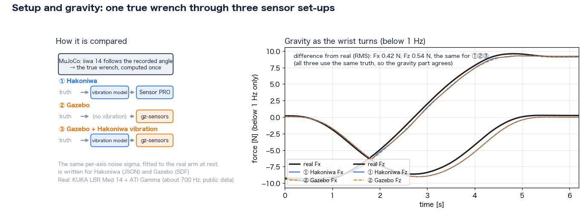
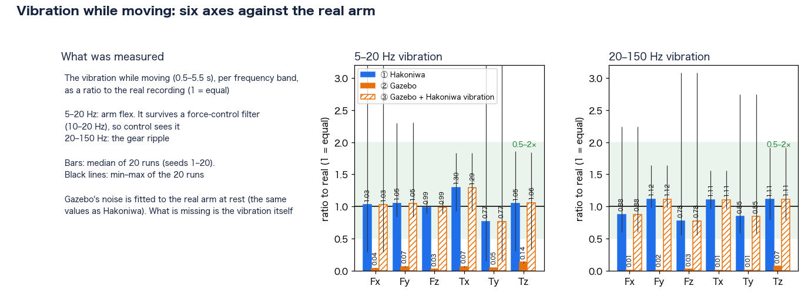
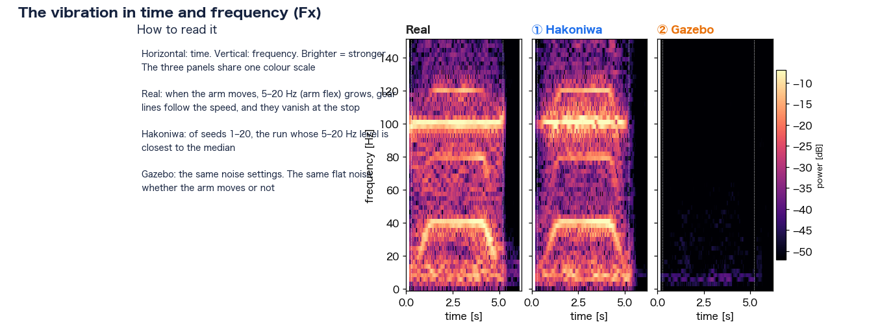
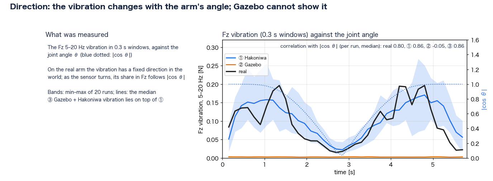
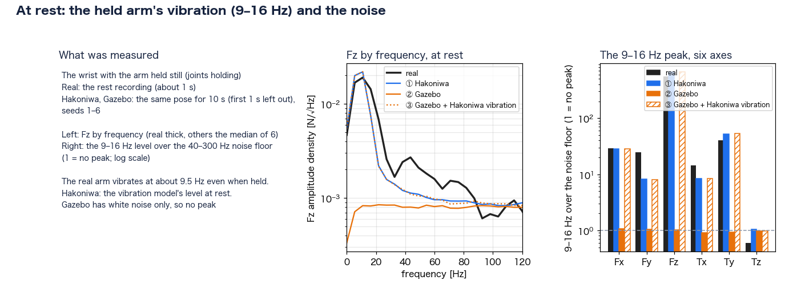

# Wrist force-torque sensor against a real recording: Hakoniwa and Gazebo (2026-11-21)

English | [日本語](gazebo-comparison.ja.md)

How close does a simulated wrist force-torque sensor come to a real one? One real recording of a KUKA arm is the yardstick, and the same true wrench goes through three sensor set-ups:

1. **Hakoniwa**: Sensor PRO with the vibration model in front of it.
2. **Gazebo**: gz-sensors 10.2.0, the Gazebo implementation itself.
3. **Gazebo + Hakoniwa vibration**: Hakoniwa's vibration model in front of Gazebo's sensor.

The physics is the same for all three: MuJoCo computes the wrist's true wrench once, and only the sensor is swapped, through the common interface of [hakoniwa-sensor-adapter](https://github.com/hakoniwalab/hakoniwa-sensor-adapter).

**In short.** All three agree on the gravity part and on the noise. While the arm moves, the real sensor also carries the arm's vibration: Hakoniwa reproduces 0.77–1.30 times its 5–20 Hz level on the six axes; Gazebo, which has no model of it, gives 0.03–0.14 times. Put Hakoniwa's vibration model in front of Gazebo's sensor and Gazebo gives what Hakoniwa gives.

## What is compared, and how

- **Real**: Zenodo record 11096791 (A. Skrede, 2024, CC BY 4.0). A KUKA LBR Med 14 with an ATI Gamma force-torque sensor (about 700 Hz) and a 0.93 kg tool turns one joint by 180° in about 5 s; a separate recording holds the arm still for about 1 s. The sensor bias fitted on the recording's 24-pose calibration is removed.
- **Simulated**: a KUKA iiwa 14 (MuJoCo Menagerie) follows the recorded joint angle; the wrist's true wrench is computed once and passed to each sensor set-up. 20 runs (seeds 1–20) while moving, 6 runs of 10 s at rest.
- **The noise is the same for all three**: the per-axis sigma fitted to the real arm at rest is written for Hakoniwa (JSON) and for Gazebo (SDF, its per-sample `stddev`). Hakoniwa applies it as configured at this rate, and so does Gazebo (output − truth over sigma: 0.99–1.00).
- **The vibration** is Hakoniwa's model T14 (orders following the motor speed, structural modes, broadband, run-to-run variation, load direction), fitted to the same recording; its specification is public ([force-torque-vibration.md](https://github.com/hakoniwalab/hakoniwa-sensor-adapter/blob/main/docs/spec/force-torque-vibration.md)). It sits in front of the sensor, so it can feed Gazebo's sensor too.
- Gazebo's force-torque sensor has Gaussian noise, a constant bias, a slowly varying bias and quantization; it has no model of the vibration of a moving arm. That is a property of its model, not a fault in this set-up.

## Measurement cards

Colours on every card: real black, Hakoniwa blue, Gazebo orange, Gazebo + Hakoniwa vibration orange hatched or dotted.

### Setup and gravity



- **Measured:** Fx and Fz below 1 Hz (the vibration removed) as the wrist turns.
- **How to read it:** left, how the three set-ups are made; right, the real values and the simulated ones.
- **Result:** the RMS difference from the real arm is 0.42 N in Fx and 0.54 N in Fz (against a change of ±10 N), the same for all three, since they share the truth.

### Vibration while moving



- **Measured:** the vibration while moving (0.5–5.5 s) in two bands, as a ratio to the real arm. 5–20 Hz is the arm's flex, which a force-control filter (10–20 Hz) lets through; 20–150 Hz is the gear ripple.
- **How to read it:** bars are the median of 20 runs, black lines the range of the 20; 1 means equal, the green band is 0.5–2 times.
- **Result:**
  - 5–20 Hz: Hakoniwa 0.77–1.30, Gazebo 0.03–0.14, Gazebo + Hakoniwa vibration 0.77–1.29.
  - 20–150 Hz: Hakoniwa 0.78–1.12, Gazebo 0.01–0.07, Gazebo + Hakoniwa vibration 0.78–1.12.
  - Fx and Ty vary a lot from run to run in Hakoniwa (single runs 0.5–9 times at 5–20 Hz): the run-to-run variation of the model.

### Time and frequency



- **Measured:** Fx by time and frequency, the three panels on one colour scale. Hakoniwa: the run whose 5–20 Hz level is closest to the median.
- **Result:** the real arm and Hakoniwa show the same pattern — gear lines near 40, 80 and 120 Hz rising and falling with the speed, a fixed line at 100 Hz, the flex below 20 Hz, all gone after the stop. Gazebo shows none of them.

### Direction



- **Measured:** the Fz vibration at 5–20 Hz in 0.3 s windows against the joint angle θ. On the real arm the vibration has a fixed direction in the world, so its share in Fz follows |cos θ| as the sensor turns.
- **Result:** correlation with |cos θ| (per run, median): real 0.80, Hakoniwa 0.86, Gazebo −0.05, Gazebo + Hakoniwa vibration 0.86.

### At rest



- **Measured:** the wrist with the arm held still. Real: the rest recording; simulated: 10 s in the same pose, the first second left out.
- **How to read it:** left, Fz by frequency; right, the 9–16 Hz level over the 40–300 Hz noise floor (1 means no peak), log scale.
- **Result:**
  - The noise floor (40–300 Hz) is 0.88–1.07 times the real one for all three.
  - The real arm vibrates at about 9.5 Hz even when held: 9–16 Hz over the floor is Fx 29, Fy 25, Fz 561, Tx 14, Ty 40. Hakoniwa: Fx 29, Fy 8, Fz 673, Tx 8.5, Ty 53, also at 9.5 Hz in Fz. Gazebo: 0.9–1.1 on every axis (no peak).

## Summary

| | Hakoniwa | Gazebo | Gazebo + Hakoniwa vibration |
|---|---|---|---|
| Gravity part, RMS difference (Fx / Fz) | 0.42 / 0.54 N | the same | the same |
| Noise floor at rest, ratio to real | 0.88–1.07 | 0.88–1.07 | 0.88–1.08 |
| 9.5 Hz vibration at rest | yes (Fy, Tx lower than real) | none | yes |
| Vibration while moving, 5–20 Hz | 0.77–1.30 | 0.03–0.14 | 0.77–1.29 |
| Vibration while moving, 20–150 Hz | 0.78–1.12 | 0.01–0.07 | 0.78–1.12 |
| Direction of the vibration (real 0.80) | 0.86 | −0.05 | 0.86 |

## What does not match

- At rest, Hakoniwa's 9–16 Hz level is 0.34 times the real one in Fy and 0.59 times in Tx, and the real arm has more between 30 and 90 Hz than Hakoniwa.
- While moving, the shape of Fy and Tx between 15 and 30 Hz differs (see the [real-data page](https://github.com/hakoniwalab/hakoniwa-sensor-adapter/blob/main/docs/evaluation/force-torque/real-data-kuka.md)).
- One recording of one motion of one arm: the vibration settings are fitted to it and checked against it, not against other motions or arms.

## Reproducing

The data, the settings and the scripts are in this folder; see the [README](README.md):

```bash
python3 data/fetch.py
python3 compare/run_gazebo.py ../../../../hakoniwa-sensor-adapter/tools/compare/build/ft-series
python3 compare/cards_gazebo.py en
```

The commands run from this folder. `ft-series` is hakoniwa-sensor-adapter's `tools/compare` program, built with pixi against a Sensor PRO release in that checkout beside this repository (its README: "Build and run"). The simulated Hakoniwa runs are in `runs/` (they were made with Sensor PRO and the vibration model on the iiwa 14 model).
